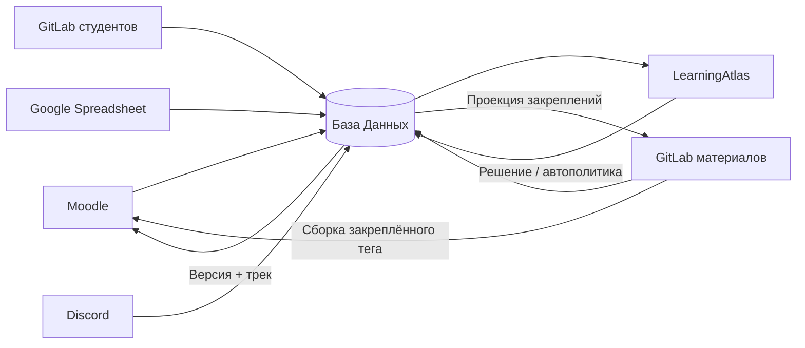
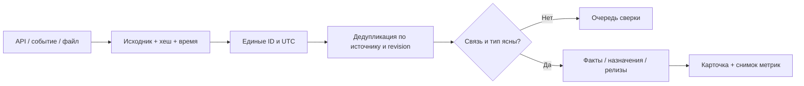

# LearningAtlas: целевая архитектура из семи систем

Актуальная модель следует уточнениям владельца проекта. Документы в `public/materials` — архив источников, а не действующие инструкции. Сайт демонстрирует архитектуру и расчёты; реальные источники и backend не подключены.

## Ответственность систем

| Система            | Хранит / определяет                                                    | Передаёт в БД                                                                 |
| ------------------ | ---------------------------------------------------------------------- | ----------------------------------------------------------------------------- |
| Moodle             | Учебные действия, попытки, завершения, сдачи ссылок                    | user/course/activity IDs, попытки, оценки, completion; событие первого старта |
| GitLab материалов  | Исходники, защищённые теги, неизменяемые сборки, утверждённый манифест | Релиз, commit SHA, хеш манифеста, явные карты совместимости                   |
| GitLab студентов   | Практический код, MR, CI, review и комментарии                         | Факты сдачи, проверки и ссылки; отдельное решение о зачёте                    |
| Google Spreadsheet | Личные/групповые назначения, сроки, при настройке оценки               | Типизированные строки со стабильным row_id и revision                         |
| Discord            | Сообщения с уточнениями                                                | Исходное сообщение, автор и область; кандидат изменения после разбора         |
| База Данных        | Исходники, идентичности, факты, карточки, треки, закрепления и аудит   | API карточек и снимков; очередь команд в Moodle/GitLab                        |
| LearningAtlas      | Статистику и интерфейс решений                                         | Команды назначения трека / перехода с revision и request_id                   |

CI, фоновые jobs, бот Discord, компонент доставки и API карточек находятся внутри этих семи контуров. Они не образуют дополнительные глобальные системы. Для курса без кода студенческий GitLab не подключается; GitLab материалов остаётся источником версий.

## Словарь и структура

Теория / практика / тест — виды активности. Несколько активностей образуют юнит, несколько юнитов — модуль, модули входят в версию курса. Это принятая для проекта терминология.

Учебный трек выбирает из каталога версии обязательные активности конкретного студента; фиксирует сроки, веса и правила принятия. Попытка, балл, MR, Comment и дедлайн описывают выполнение или условия назначения, а не части содержания. PR — название GitHub; в GitLab используется MR. Карточка связывает трек, версию и результаты одного студента.

## Закрепление и доставка

1. При первой учебной активности Moodle передаёт проверенный user_id/course_id компоненту закрепления.
2. БД в транзакции создаёт единственное закрепление на последний разрешённый опубликованный тег. Уникальный ключ `(student_id, course_id)` защищает от одновременных стартов. Повторный старт читает существующую запись.
3. Вместе с изменением карточки сохраняется outbox. Job обновляет защищённую проекцию `student-course-versions.json` в GitLab материалов и конфигурацию Moodle. Допустима пакетная публикация проекции; персональные сведения и оценки туда не входят.
4. Moodle-плагин / аутентифицированный сервис доставки выбирает точную неизменяемую сборку по закреплению в БД. Статическая сборка сама не узнаёт пользователя. Права проверяются до выдачи артефакта; прямой адрес чужой версии не даёт доступа.
5. Если проекция GitLab задержалась, БД остаётся основой. При недоступности компонента доставки допустим только проверенный кеш действующего закрепления; без него урок временно не запускается. Подмена на latest запрещена.

## Манифест и перенос

Манифест версионируется вместе с релизом и содержит опубликованный тег, commit/hash, критичность, область действия, критерии оценивания и явную карту `from → to` по стабильным activity_id. Совместимость соседних версий не означает автоматическую транзитивную совместимость.

| Правило     | Что происходит                                                                            |
| ----------- | ----------------------------------------------------------------------------------------- |
| Перезачесть | Принятый совместимый результат переносится с основанием; несданный не становится принятым |
| Повторить   | Требуется новая попытка по новым критериям                                                |
| Дополнить   | Старая попытка остаётся в истории, назначается недостающая часть                          |
| Убрать      | Обязательство исключается из нового трека, прежняя история сохраняется                    |
| Новое       | Создаётся новое назначение, срок задаётся отдельно                                        |

Job сравнивает закрепление с утверждённым манифестом. Критическое отличие попадает в карточку и подсвечивается в LearningAtlas. В ручном режиме решение принимает уполномоченный преподаватель. В автоматическом — действует разрешённая владельцем политика, отдельно указывающая, можно ли назначать новые/повторные работы. Неполная/неоднозначная карта, неутверждённый релиз или устаревшие данные блокируют перенос.

Сохранение выполняется с ожидаемой revision карточки и уникальным request_id. Версия, новая ревизия трека, результаты переноса, история и outbox записываются одной транзакцией. Повтор команды идемпотентен, запоздалое событие не откатывает новую проекцию. Перезачёт не создаёт фиктивную Moodle-попытку. Старые оценки и назначения остаются воспроизводимыми.

## Сбор, классификация и приоритеты

Источники читаются по страницам с курсорами и повтором неудачных запросов. Webhooks/Gateway ускоряют доставку; периодическая REST-сверка восстанавливает пропуски. Бот Discord читает разрешённые учебные каналы; incoming webhook не является API чтения чатов. Сохраняются автор, message_id, правки и исходная цитата.

Ключ факта включает источник, экземпляр, тип, внешний ID и revision. Повтор той же редакции пропускается; новая редакция сохраняется рядом с прежней. Факты упорядочиваются по времени события, затем по ключу. Внешние аккаунты связываются со student_id через реестр; совпадение имени не подтверждает личность. Неуспешная загрузка помечает свежесть, но не удаляет результаты.

Sheets-назначение и Sheets-оценка — разные типы данных. Групповой шаблон разворачивается в личные назначения; явное личное исключение сохраняет приоритет до отдельного решения. Discord-уточнение меняет срок только после проверки автора, задания, области и часового пояса. Политика курса выбирает основной источник оценки либо утверждённую коррекцию; конфликт не решается молчаливым усреднением или принципом «последний победил».

## Пайплайны, ИИ и решения

- Jobs: API/CSV, ID, UTC, дубли, типизация, формулы, сравнение манифестов, перенос по явным правилам, синхронизация проекций.
- ИИ: разобрать свободный текст Discord/Sheets, предложить связь MR с задачей, review кода по заданной рубрике (например, Claude Code).
- Человек / разрешённая политика: подтвердить неоднозначность, право менять условия, зачёт работы и переход версии. Для ИИ сохраняются модель/шаблон, цитата, уверенность и итоговое решение.

CI запускает тесты кода отдельно от AI-review. Review не равен автоматическому зачёту; автозачёт требует заранее проверенной политики. Студенческий код выполняется в изолированной job без рабочих секретов.

## Статистика

Три масштаба: студент, группа и курс. Прогресс = сумма принятых обязательных весов / сумма назначенных обязательных весов. Каталог Moodle не является знаменателем. Средние оценок по несовместимым критериям не объединяются; показываются отдельно по версиям. Нет оценки отличается от 0, неизвестный результат — от просрочки. Сдача и принятие раздельны; несколько MR одной задачи не увеличивают количество зачтённых заданий.

Сайт демонстрирует общую карточку: назначение трека, подтверждённое уточнение и смена версии отражаются в статистике после перехода между разделами. Состояние сохраняется в памяти приложения до перезагрузки. Дата среза синтетических данных — 16.10.2026, 12:00 UTC.

## Линейка MVP

1. Moodle + GitLab материалов + БД + LearningAtlas: закреплённая версия и личный прогресс.
2. Sheets: групповые/личные треки, сроки, отчёты по группе и курсу.
3. GitLab студентов: MR, CI, review и отдельный зачёт практики.
4. Discord: уточнения и конфликты; целевой контур всех семи систем.
5. Ручные миграции: манифест, покрытие, история и надёжная доставка закреплений.
6. Настраиваемые автотреки/автопереходы и проверенная помощь ИИ.

Схемы показывают предлагаемую реализацию, а не уже работающую интеграцию. Перед подключением уточняются точное событие старта, API и права, рубрики, веса, роли и правила исключений. Числа и правила манифеста на сайте — демонстрационные.
