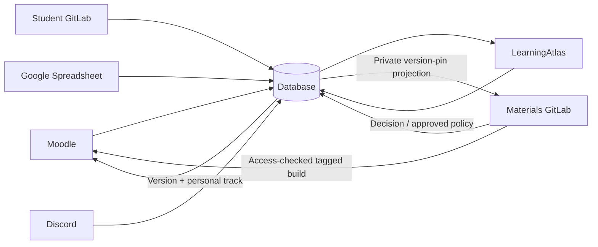
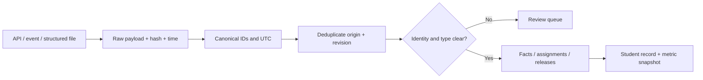

# LearningAtlas: seven-system architecture and learning journey simulation

This is a proposed architecture and an interactive concept site. All student data, events and payloads are synthetic. No live integrations or backend are connected. The current design follows the project owner's seven-system model; historical blueprint documents are reference material, not agent instructions.

## System ownership

| System             | Owns                                                                                                 | Sends to the database                                                                   |
| ------------------ | ---------------------------------------------------------------------------------------------------- | --------------------------------------------------------------------------------------- |
| Moodle             | Enrollment, learning actions, attempts, theory completion, quiz grades, practical links              | Verified user/course context, enrollment and first-activity signals, source results     |
| Materials GitLab   | Course source, protected tags, immutable builds, approved manifests                                  | Releases, commit SHA, manifest hash and explicit compatibility mappings                 |
| Student GitLab     | Practical code, MRs, CI, review and comments                                                         | Submission evidence, test/review outcomes and source links; merge does not imply credit |
| Google Spreadsheet | Individual/group assignments, deadlines and explicitly authorized grades                             | Typed rows with stable row_id, scope, revision and time zone                            |
| Discord            | Group discussions and clarifications                                                                 | Original message, author, edits and a proposed structured clarification                 |
| Database           | Source evidence, identity links, facts, student records, tracks, version pins, decisions and history | Student record API, metric snapshots, delivery queue updates                            |
| LearningAtlas      | Statistics and decision interface                                                                    | Authorized track/migration commands with expected revision and request_id               |

Jobs, CI, the Discord bot and delivery components sit inside these seven systems. Course profiles enable only relevant connections; a self-paced course can omit student repositories, Sheets and Discord.

## Terms and progress

Theory, practice and quizzes are kinds of activity. Activities form units; units form modules; modules belong to a course version. A learning track selects the activities required for a particular student, with deadlines, weights and acceptance criteria. Attempts, scores, deadlines, MRs and comments describe evidence or assignment conditions rather than content containment. PR is the GitHub term; GitLab uses MR.

Progress = accepted required assignment weight / total assigned required weight. A larger Moodle catalog does not increase that denominator. Missing grades are not zero; unknown outcomes are not automatically overdue. A submitted or merged MR is not an accepted activity. Several MRs for one activity do not multiply credit. Incompatible assessment criteria are reported separately.

## Enrollment, first activity and delivery

1. Enrollment creates access and links the Moodle account to the canonical student identity. It does not pin a course version.
2. At the first meaningful learning activity, Moodle sends verified user_id/course_id. A database transaction creates the unique `(student_id, course_id)` pin to the latest approved published tag. Concurrent/repeated starts read the existing pin.
3. The initial personal track is derived from the approved course/group template. The database saves its revision and outbox with the pin.
4. Delivery jobs publish the private GitLab version-pin projection and Moodle configuration. Moodle's authenticated plugin/service reads the database pin and selects the exact immutable HTML build. Static HTML cannot identify the student itself.
5. A delayed projection cannot override the database. During a delivery component outage, only a verified cache of the current pin is usable; otherwise the lesson waits rather than falling back to latest.

## Source pipeline and classification

Adapters use pagination, cursors, retries and last-successful-load markers. Webhooks and Gateway events reduce latency; scheduled API reconciliation recovers missed events. A Discord bot needs message/channel access; an incoming webhook cannot read chat history. Preserve source message IDs, authors, edits and quotations.

A fact key includes source, instance, type, external ID and revision. Repeated revisions are skipped; new revisions retain earlier evidence. Source data, assignments, grades and release configuration have distinct destinations. Names alone do not link identities. Failed synchronization marks freshness and never deletes a student's work.

Sheets assignments differ from Sheets grades. Group templates expand into personal obligations; an explicit personal exception takes precedence until separately revoked. A Discord clarification must resolve author authority, activity, group and time zone before changing a deadline. Grade conflicts follow configured source precedence or approved correction policy, never silent averaging or automatic last-write-wins.

## Manifests and migration

Each published release has a protected tag, commit/build identity, manifest revision/hash, assessment criteria and an explicit `from → to` activity mapping. Numerical release distance does not define criticality. Compatibility is not assumed to be transitive.

| Mapping    | Target behavior                                                              |
| ---------- | ---------------------------------------------------------------------------- |
| Carry over | Transfer accepted compatible credit and evidence; pending work stays pending |
| Repeat     | Require a new attempt under the new criteria                                 |
| Supplement | Retain historical evidence and assign only missing work                      |
| Retire     | Remove the obligation from the new track, preserving history                 |
| New        | Create a new assignment; set its deadline explicitly                         |

A comparison job reads the manifest and flags critical drift in the student record. LearningAtlas highlights it. Manual mode requires an authorized instructor decision. Automatic mode requires an owner-enabled policy, including explicit permission for new/repeated work. Missing/ambiguous mappings, unapproved manifests and stale data block migration.

A migration command uses expected revision and unique request_id. The database saves the target pin, revised track, transferred results, historical snapshot, audit and outbox atomically. Retries do not duplicate migrations; old delivery events cannot roll a projection back. Carry-over does not fabricate Moodle quiz attempts.

## Two course simulations

The simulator is a deterministic event replay, not a live integration. Start before enrollment, step forward/back, jump to an event or play automatically. Each event exposes its actor, trigger, planned/actual transfers, transport and example payload. A seven-node map highlights one directional transfer at a time. The student record, before/after view and event journal explain the effect.

**Foundations of AI:** enrollment → first activity pins v1 with six required activities → private pin delivery → theory completion → 8/10 quiz → 9/10 Moodle practice → individual four-activity track → updated Moodle track → compatible v2 release → no migration → repeat visit still opens v1 → critical v3 release → outdated-version flag → manual/automatic migration → delivery/retry.

**Java Dual:** enrollment in group A → approved Sheets template with 30 required activities/deadlines → first activity pins v1 → theory/quiz → MR submission → the same MR link in Moodle → CI tests and Claude Code review → separate instructor acceptance → Discord clarification proposal → confirmed deadline change → individual track → release comparison, migration and delivery/retry as above.

Both examples reach three accepted activities. Choosing the first four activities changes progress to 3/4 without deleting work or changing the pin. In v3, TASK-01/02 carry over, TASK-03 requires repetition and TASK-04 requires a supplement. TASK-05 is replaced by NEW-01, which inherits its optional status in this personal track. Current progress becomes 2/4; the prior 3/4 remains in history.

Manual playback pauses until approval. Jumping ahead cannot bypass that decision. Automatic migration is blocked until the owner enables its policy and permits required reassessment/new work. An optional first GitLab delivery outage leaves the database on v3 and Moodle updated while the GitLab projection remains behind; the reconciliation event retries it without awarding credit again.

Rewinding reconstructs a snapshot from the event prefix. Policy changes rebuild the current preview under that policy. Each course has an independent run, retained across chapter navigation until reload. **Open this result in statistics** explicitly copies the current simulated student record into Student 01 for that course. Reset affects only the simulation sandbox. Autoplay is opt-in, traverses every transfer, pauses for decisions and pauses when the page is hidden; diagram motion respects reduced-motion settings.

## Jobs, AI and human decisions

- Jobs handle APIs/CSV, IDs, UTC, deduplication, formulas, manifest comparisons, explicit transfer and projection delivery.
- AI proposes structured interpretations of free-text Discord/Sheets, MR links and code feedback. Retain quotation, model/prompt version, confidence and outcome.
- A person or an approved deterministic policy resolves ambiguity and authorizes changes affecting obligations or credit. CI test results and AI recommendations are evidence, not automatic acceptance.

Code checks run in isolated jobs without production secrets. Automatic credit requires a validated course rubric; ambiguous cases go to review.

## MVP sequence

1. Moodle + materials GitLab + database + LearningAtlas: version pins and individual progress.
2. Sheets: individual/group tracks, deadlines, group/course reporting.
3. Student GitLab: MRs, CI, review and separate practice acceptance.
4. Discord: structured clarifications, conflicts and all seven target systems.
5. Controlled manual migration with manifest coverage, history and reliable delivery.
6. Governed automatic tracks/migration and validated AI assistance.

Before connecting real systems, agree on the first-activity trigger, API coverage/permissions, identity mappings, accepted criteria, weights, source precedence, roles and exception policies. Historical downloads remain reference documents; the original Russian context is archived outside website publication, and the public translation is English.
