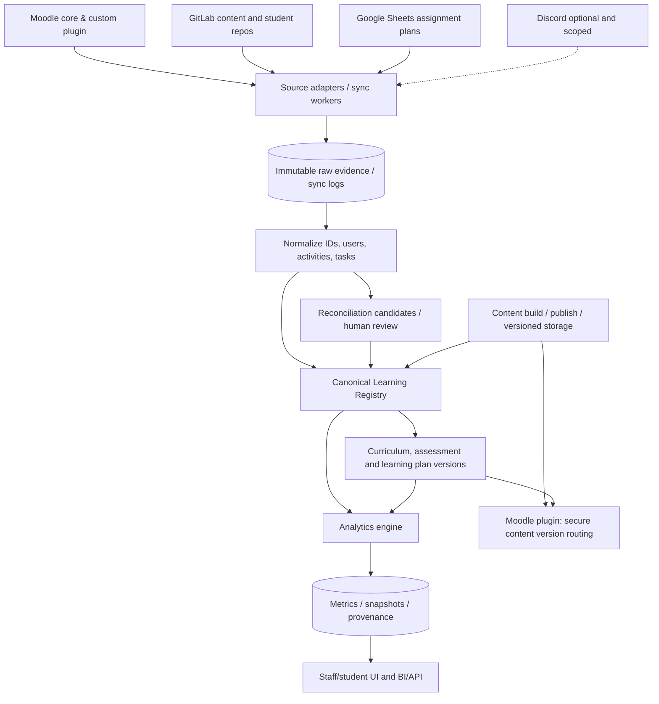

# 01 — Architecture: from fragmented learning systems to a unified analytics platform

## 1. Vision, boundaries and operating principles

**Product goal:** a flexible, auditable analytics platform for learning programs that may use any combination of Moodle, a custom AsciiDoc→HTML plugin, native Moodle Quiz/Assignment/H5P, GitLab source/content/student repositories, Google Sheets and, optionally, Discord. Show individual and group completion, graded performance, timely delivery, dynamics, version health, assignment status, human review, and explainable educational profiles. Refresh routinely (initially 1–2 times/day) while allowing fast synchronous selection of content versions on page load.

**Do not build another LMS.** Moodle remains the place learners access activities and receive grades. The new platform provides an independent **canonical learning model** and analytics: it does not assume that every Moodle activity is required, that a GitLab merged MR is accepted, or that a spreadsheet is the durable historical truth.

### Architectural invariants

1. Sources may be messy and mutable; canonical identifiers, accepted facts and historical plan snapshots must be controlled.
2. **Immutable artifact**, **curriculum definition**, **assessment policy** and **learner-specific plan** are different objects with different lifecycles.
3. A student's progress is evaluated relative to the snapshot of requirements assigned to that student. Any migration explicitly creates a new plan revision.
4. `submitted`, `reviewed`, `accepted`, `completed` and `graded` are distinct states; neither MR merge nor presence of an assignment link guarantees acceptance.
5. Never infer “task removed” from a failed sync. Record source health and explicit tombstones/deletion confirmations.
6. A grade or completion status must be traceable to underlying records, rule version, calculation time and human decisions.
7. Allow multiple pieces of evidence per assignment and multiple assignments per MR.
8. Human confirmation of `MR ↔ task` proves only association, not quality/completion.
9. No hidden automatic migration, regrading, email-based version routing from untrusted client input, or irreversible grade overwrite.
10. New content platform cannot be a dependency for MVP analytics. Migration follows a strangler/adapter approach.

### Architecture at a glance

## 2. Terminology — controlled glossary

| Term | Definition | Example / warning |
|---|---|---|
| Learning Program | Educational product independent of delivery platform | `AI-BASICS`, `JAVA-DUAL` |
| Moodle Course Instance | A specific technical course object in a specific Moodle installation | `(moodle_site_id, course_id)`; not a version |
| Cohort / Group | A student set or intake with shared rules, optionally absent | Java A/B; AI self-paced has no cohort |
| Enrollment | Membership/eligibility in a Moodle course | Is **not** necessarily start of learning |
| Learning Instance | One student's concrete attempt to go through a program, with start and lifecycle | Re-enrolling can create another instance |
| Content Unit | Stable logical material/activity identity | `AI-INTERACTIVE-007` |
| Content Artifact / Build | Immutable published HTML/H5P/document produced from source | SHA-256 and immutable URL |
| Content Version | Release identifier for a specific content unit or bundle | `1.3.0`; not sufficient to identify assessment |
| Assessment Definition | An evaluative activity and its scoring/attempt rules | Quiz with 10 points |
| Assessment Version | A stable version of grading criteria/questions/scale | Separate from CSS-only content changes |
| Curriculum | Educational structure, tasks, sequencing, requirements, skills | Includes optional and required activities |
| Curriculum Version | Immutable set of program requirements and compatible content/assessment references | `AI-BASICS@5.0` |
| Learning Plan | Student's applicable required work, weights, deadlines, versions and exceptions | Does not equal all Moodle course contents |
| Learning Plan Revision | Immutable snapshot of a learning instance's requirements at a point in time | `LI-1045@R2` |
| Assignment (canonical) | Obligation assigned to individual/group within a plan | Distinguish from Moodle `mod_assign` |
| Moodle Assignment | Particular Moodle activity where submission/URL/grade is recorded | May collect multiple task links |
| Task | Stable logical skill/learning work to complete | `JAVA-LOOPS-011` |
| Task Version | Version of task content/requirements | Not automatically new Moodle activity |
| Evidence | Observable data that can support a result | Quiz attempt, grade, GitLab MR, submitted link |
| Submission | Evidence of handed-in work | Not yet an accepted grade |
| Attempt | Individual evaluation try with its time and result | May have multiple attempts |
| Result / Acceptance | Decision that an obligation is satisfied under a specific grading policy | `accepted` requires rule or teacher decision |
| Grade Item | Entry in Moodle gradebook; not necessarily 1:1 with canonical task | Different assessment versions may need distinct items |
| Source Connector / Adapter | Integration for one external system | Moodle read-only API adapter |
| Source Snapshot | Fetched dataset with source timestamp, checksum, sync info | Historical replay and diff |
| Canonical Learning Registry | Controlled mapping of programs, activities, tasks, students, groups, releases, plans | Source-of-truth for applicability |
| Identity Link | Link between Moodle user and GitLab identity, with confidence/approval | Email as initial hint only |
| Reconciliation | Candidate matching and conflict resolution across source records | MR !42 ↔ `JAVA-011` |
| Human Review Case | A specific unresolved question routed to staff | Explicit options, evidence and audit |
| Matching Rule | Scoped, versioned rule reusing confirmed relationships | Repo + path pattern + task version |
| Data Provenance | Chain linking metric → result → evidence → raw source | Explainability |
| Metric Definition Version | Version of a formula/denominator/grading policy | Historical comparisons need it |
| Metrics Snapshot | Stored student/group measurements for as-of time and plan revision | No disappearing history |
| Learning Pace Gap | Actual minus expected progress for same plan and date | Compare to scheduled work, not whole catalog |
| Data Health | Coverage, freshness, conflicts and completeness of incoming data | Missing evidence ≠ failed task |
| Version Lock | Student stays on the curriculum/content versions assigned at start | Stable until explicit migration |
| Migration Preview / Dry Run | Safe simulation of changed obligations/results before applying | Preview can show old/new percentages |
| Carry Over | Explicit compatibility-based transfer of accepted result | Not inferred from title similarity |
| Reassess | New assessment is required | Preserve old historical grade |
| Supplement | Partial additional work required | Needs explicit target obligation |
| Retired | Task removed from target plan; old result kept historically | Do not delete evidence |
| Version Health | Whether instance uses still-supported curriculum/content | Not equivalent to student performance |
| Legacy Builder | Current AsciiDoc + ad-hoc HTML assembly | Continues working during transition |
| Interactive Runtime Contract | Stable launch/results integration semantics regardless of front-end technology | Browser data is not trusted grade authority |
| Content Version Resolver | Service/module choosing locked artifact for authenticated learning instance | Must be synchronous with fallback policy |
| Release Manifest | Immutable mapping of curriculum units to artifact/assessment IDs and hashes | Never overwrite released manifest |

## 3. The two pilot course models

### A — AI Basics: Moodle-only learner interaction

- Student sees Moodle native activities and custom HTML/JS interactives embedded using the existing plugin/iframe; HTML is built from GitLab/AsciiDoc, but GitLab is **authoring storage**, not student-submission evidence.
- Moodle grades, activity completion, Quiz attempts, plugin outcomes are initial sources. Whether plugin records individual tries beyond final score must be discovered; **do not fabricate unavailable history**.
- No groups needed. Upon **first meaningful start**, atomically create `LearningInstance` and lock `CurriculumVersion` + `LearningPlanRevision 1`. Mere enrollment is not a start unless course policy says so.
- If authoring changes publish v2...v5, the learner stays on old version until completion or reviewed migration. A single Moodle course can host different versioned HTML bundles, **provided content router honors lock**.
- If assessment meaning changes, a different assessment version and potentially a new Moodle grade item/activity or plugin-supported virtual assessment is needed. A shared grade item is not automatically comparable.

### B — Java Dual Training: group-tailored, multi-source

- 80+ learners across groups. One large Moodle course acts as library of presentations, H5P, tests, custom plugin and native assignments; presence of 100 activities does not make all mandatory.
- Google Sheets may specify group/individual homework, required flag, weights, effective deadlines, overrides. Sync produces **proposed changes**; publish of a new group plan revision is separate from reading the sheet.
- Students submit MR URLs into Moodle assignments; student GitLab subgroups/repositories/branches can be inconsistent. Discover the exact source mapping. One Moodle assignment may gather several MRs; one MR may cover several tasks; one task may have multiple MRs.
- Program completion = obligations in the learner's plan. Submission, accepted status and grading must remain distinct. Teacher acceptance may come from Moodle grading or configured GitLab review policy; ambiguous links require review.
- Group plan starts as template; materialize per-student plan with individual exceptions and stable deadline snapshots. Overrides have documented precedence.

### Optional course combinations

| Model | Sources | Plan policy | Core metric differences |
|---|---|---|---|
| Moodle-only | Moodle/plugin | Individual version lock or cohort template | Completion and grades from Moodle |
| Moodle + GitLab content | Moodle + authoring GitLab | Individual lock plus content release manifest | Track which build student saw |
| Moodle + GitLab homework | Moodle + student repos | Per-student assigned tasks | MR evidence and review coverage |
| Moodle + Sheets | Moodle + Sheets | Sheet drafts → published plan revisions | Applicable tasks/deadlines from registry |
| All optional sources | Above + Discord | Never require Discord for core completion unless explicitly specified | Optional event signal, privacy controls |

## 4. Ownership and source setup

| Capability | Moodle | GitLab | Sheets | Analytics / Registry |
|---|---|---|---|---|
| User learning identity | Authenticated primary identity | Secondary identity link | May contain aliases | Canonical cross-system mapping |
| Course access/learning | Yes | No | No | Mirrors, does not replace |
| Quiz/assignment grades | Primary authoritative source for those activities | Never automatically from MR merge | Optional manual marks only by explicit policy | Normalizes, records provenance |
| Content authoring | Optional | Usually primary when repo exists | No | References immutable artifacts |
| Homework deadlines | May exist | Rarely authoritative | Often convenient source | Resolves precedence and snapshots |
| Canonical assignment applicability | Not implied by visibility | Not implied by MR | Input proposal | **Authoritative published plan** |
| Curriculum version | Not natively source of truth | Release manifests can define | Can propose | **Authoritative** |
| Analytics/history | Partial data | Partial data | Mutable | **Authoritative derived records and audit** |

### Source onboarding workflow

1. Admin creates `Program` and enters URLs/identifiers: Moodle course (required in pilots), optional content repo, GitLab student groups/projects, Sheets URLs/ranges; Discord only as a later opt-in.
2. Establish read-only service account(s) with least-privilege scoped tokens. Do not accept arbitrary pasted URLs as sufficient authorization. Secrets in secrets manager or protected env vars; never UI logs.
3. Connection probe checks permissions, API version, endpoint coverage, pagination/rate limits and freshness. Each source has `status: healthy | partial | unavailable`.
4. Discovery inventories Moodle modules, instance IDs, grade items, enrolled learners, completion flags and available attempt history. GitLab inventories project/subgroup topology, MR metadata and linked URLs. Sheets sample ranges, headers, assignment hints.
5. Generate `source_mapping_candidates` with stable internal IDs. Unmapped records retained; no silent discard.
6. Admin reviews catalog + source authority policies. Freeze `CurriculumVersion` and first group/student plan snapshot(s) only after applicability is confirmed.
7. Run baseline reconciliation and test against manually validated representative students.
8. Start incremental sync 1–2 times/day; re-fetch changed records and regularly run reconciliation/full check.

### Moodle specifics

- Discover exact Moodle core/plugin version, custom plugin code path and capabilities before naming concrete endpoints. Relevant standard functions often include course contents, activity completion, grade items, quiz/assign functions; some fields may require a new plugin webservice.
- Prefer Moodle External API + custom plugin read-only endpoint for missing data, and Moodle Events observers for future events. Current plugin score write must remain untouched during first pilot.
- Store instance/site identifiers and plugin-specific activity IDs; do not treat `cmid` as stable across copied courses.
- Quiz attempts/history, H5P results, native assignment statuses and gradebook semantics must be validated separately. Gradebook final value is not a complete attempt timeline.
- Native Moodle activity access restrictions and grade items can differ by group, but should not be forced solely for analytics.
- For custom iframe content, secure launch context must come from authenticated Moodle server, not `?email=` or guessed Moodle user ID.

### GitLab specifics

- Authoring repositories: record commit SHA, tag/release, build pipeline, artifact digest and immutable delivery URL. Student repositories: collect MR project ID + IID, head SHA, author/participants, changed files, timestamps, comments, approvals, pipeline state and links submitted to Moodle.
- Hook events are signals, not full authoritative history; combine with periodic API reconciliation. Do not mark missing MR deleted merely because a sync failed.
- Handle permissions across nested groups, forks, private projects and repositories that students create late.

### Sheets specifics

- Support **managed** (recommended stable columns and task IDs) and **imported legacy** (configurable column mappings, several sheets, date parsers, header aliases).
- Treat sheet writes as proposed configuration modifications. Every approved change becomes a plan revision; raw tab/row identity + file revision/checksum go into audit.
- Deadline priority proposal: student override > group assignment > cohort policy > curriculum default. Allow local rule override with explicit audit.
- Preserve timezone and deadline interpretation (inclusive/exclusive, original authored timezone); never silently infer if ambiguous.

### Discord (post-MVP)

- Not required for grades/completion. Integrate only explicitly opted-in, education-specific events; don't use chat volume, hours online or message count as proxy for character, motivation or competency. Keep permissions, consent/notice, retention and deletion policies explicit.

## 5. Source → canonical normalization, reconciliation, identities

1. Save raw responses with source object identity, fetched-at time, source-updated-at if available, payload hash and sync run ID.
2. Normalize source IDs to `source_system + source_instance + object_type + external_id`; idempotent upserts, backfills and deletions recorded as events.
3. Create canonical learner identity keyed internally, and `(moodle_site_id, moodle_user_id)` as reliable Moodle identity. Cross-system email is a **hint**, not authentication or immutable identity.
4. Generate task candidates from canonical catalog; exclude impossible versions/plan states while retaining out-of-plan evidence for review.
5. Deterministic links first: submitted explicit MR URL, stable task ID, prior human-approved mapping, scoped filename mapping. Then names/diffs/branch/commit clues, optionally embeddings/LLM ranking.
6. Confidence score is a ranking indicator, **not a factual probability** without calibration; inspect top-1/top-2 margin, hard conflicts and scope before auto acceptance.
7. Human review UI shows side-by-side evidence, potential 1:N and N:1 links, acceptance policy, choices: confirm links, exclude non-learning, resolve identity, defer, override. Confirmed link ≠ grade accepted.
8. Write immutable `ReviewDecision` and scoped `MatchingRule` with author, justification, input revision, engine/rule version and reversible superseding decisions.
9. Recompute only affected metrics, not entire course, and expose provenance to staff.

Example ambiguous cases: one MR with `Task10.java` and `Task11.java`; several resubmission MRs for one task; fork author differs from learner; MR URL in generic Moodle assignment; old MR after a curriculum migration. Keep `UNRESOLVED` rather than guessing.

## 6. Versioning model and policies

**Levels:** `ContentArtifact/Version`, `AssessmentVersion`, `CurriculumVersion`, `LearningPlanRevision`, `MetricDefinitionVersion`. These are not synonyms.

### Immutable release contract

A curriculum release manifest pins ordered units/tasks, required/optional flags, dependencies, content artifacts + SHA, assessment versions, weights and skill tags. Publishing creates a new immutable release. `latest` is a mutable pointer for **new entrants only**; already locked instances never resolve via latest.

Content may evolve without changing assessment. When assessment questions, scoring, skills or completion rules materially change, publish new `AssessmentVersion` and define compatibility. New assessment may require a new Moodle activity/grade item; do not overwrite old grades to simulate migration.

### AI Basics — version lock algorithm

1. Determine meaningful learning start (`explicit_start`, first assessment attempt, or custom plugin event). Enrollment alone does not count by default.
2. In a transaction with uniqueness on `(program_id, moodle_site_id, moodle_user_id, attempt_sequence)`, create one `LearningInstance` and `LearningPlanRevision R1` based on the **current stable, released** curriculum. Persist artifact/assessment references. Concurrency-safe repeat requests get existing lock.
3. Moodle plugin requests resolver synchronously using authenticated session context. Resolver returns artifact URL/version and launch token. Never use student-supplied email or user ID.
4. Serve versioned immutable HTML. For private content use short-lived signed launch token with audience, activity, version, expiry and replay protections as appropriate. Validate frames, origin and CSP; don't trust arbitrary client score payload.
5. If resolver unavailable, use cached **previously verified lock** for that same user/activity with limited TTL; otherwise fail closed with helpful message. **Never fall back to latest** for a locked learner.
6. Save attempt with `assessment_version` and `artifact_hash`; plugin's legacy score sync continues after rollout validation.
7. On program completion, freeze completion version/time and retain records. Repeat enrollment is a new `LearningInstance` if policy permits.

### Learning duration and version health

- Configure expected duration, warning/critical thresholds, grace period, official pause handling, version support sunset, severity of release changes, contact policy and privacy/roles.
- Actual duration = current as-of time minus meaningful start minus approved pauses (if policy allows). Compare separately with expected target. Example: expected 30 days, actual 240 days = 800% elapsed; not automatically 800% late on every assignment.
- Distinguish `DURATION_OVERDUE`, `VERSION_OUTDATED`, `CRITICAL_CONTENT_UPDATE`, `INACTIVE`, `AT_RISK` and data-health warning; alerts are recommendations, not automated migrations.
- If version v1 is four releases behind, check **compatibility/severity**, not just count of versions.
- Old learner with 98% progress may be better allowed to finish; manual review selects appropriate action.

### Migration between versions

1. Staff selects target version; server verifies target released and access roles.
2. Dry run compares old/new tasks by stable ID, **assessment policy/version and explicit compatibility map**. Return `CARRY_OVER`, `REASSESS`, `SUPPLEMENT`, `NEW_REQUIRED`, `RETIRED` or `MANUAL_REVIEW`. Never infer transitive equivalence automatically.
3. Show old/new denominators, weights, progress, scores, outstanding work, deadlines and affected Moodle objects **with evidence provenance**; prompt explanation for overrides.
4. Require explicit approval. Apply in a transaction with optimistic concurrency (`expected_plan_revision`, changed source hashes) and idempotency key; create **new** immutable plan revision, migration event and recalculation record. Do not overwrite old evidence, attempts or historical gradebook.
5. For Moodle native Quiz/Assignment, carrying an external analytic credit does not create a genuine historical Quiz attempt or Moodle completion. Decide separately how student-facing grade/completion visibility is handled. This may require a new activity/grade item or targeted plugin support.
6. Provide compensating migration/rollback with audit; never delete history. One migration may expose old and new progress side by side.

### Java plan revision policy

Group template from Sheets is materialized into individual plans, including student exceptions. New rows are `proposed_plan_changes`. Default for ongoing learners: no silent denominator changes; admin can accept per group, cohort or individual after preview. Assignment deadlines are snapshots with explicit overrides. If Moodle presents 100 activities, only assigned required objects are denominator.

## 7. Metrics and semantics

Every metric: ID, label, formula/SQL spec, denominator, inclusion/exclusion, version, as-of timestamp, source coverage, applicable course model and data-quality status.

| Metric | Definition / guardrail |
|---|---|
| Required completion % | `sum(weights of accepted required tasks) / sum(weights of applicable required tasks)`; unweighted option; not Moodle count |
| Submission rate % | Submitted obligations / assigned applicable obligations; distinguish submitted vs accepted |
| Average score | Normalize graded results by max points with configurable weighting; show graded coverage and no-grade vs zero |
| On-time rate | Eligible tasks submitted by **effective deadline** / tasks with evaluable deadlines and submissions; show denominator and overdue outstanding separately |
| Expected progress % | Scheduled required work expected by as-of, as per published plan/deadlines/pace curve |
| Pace gap pp | Actual completion % minus expected completion %, both in same plan revision |
| Due backlog | Required, due, not accepted count/weight; policy about late accepted work |
| GitLab submitted/accepted | Distinct required GitLab tasks with evidence; never count raw merged MR as task count |
| Review/rework | Iterations, review cycles, return-to-rework rate; avoid treating MR volume as productivity |
| Trend | Sequence of comparable as-of snapshots, segmented at migrations/rule changes |
| Version health | Old vs current curriculum, support status, compatibility severity, time over expected duration |
| Data health | Sync freshness, mapping coverage, deadline coverage, grading coverage, identity coverage, conflicts |
| Skills coverage | Skill-tagged assessed and accepted evidence only, sufficient sample threshold |

For **Moodle-only** pilot show: personal required completion, assessment average, completed/attempted activities, attempt counts only when obtainable, weekly progress delta, last meaningful activity, learning age and version health. For **Java** additionally show: group applicable completion, assignment due/overdue, submissions pending review, GitLab accepted tasks, matching queue, attempts/reworks, group averages and per-student drilldowns. Never create personality or mental state profiles from weak behavioral signals; describe educational behavior, limitations and confidence.

Historical reproducibility: store **valid/event time** and **ingested/decision time** where applicable. Allow both “what was shown on date X” and “corrected retrospective view after later grade changes.” Do not mix snapshots created under different plan/metric definition versions without labeling.

## 8. Technology choices (proposed)

- Modular backend: Python FastAPI + PostgreSQL (relational core, JSONB for raw/source metadata) + Redis/Celery or similar queued jobs; object storage such as S3/MinIO for artifacts and large raw exports. Start modular monolith, not microservices.
- UI: React/Next.js or similar; roles: platform admin, program admin, teacher/reviewer, analyst, viewer/student (later).
- Read-only source connectors and independently deployable workers; 1–2 daily incremental runs plus periodic full reconciliation. Webhooks as accelerators, not sole data source.
- BI optional: embedded app dashboard first, then Metabase/Power BI read model. Never make BI define business logic.
- AI matching after labeled dataset, with model/version/safe prompt isolation, PII minimization, human review and observability.
- Content modernization separate: existing AsciiDoc build remains, add manifests and immutable publishing, then shared runtime contract, then selective replacement of inline HTML; static interactive bundles over per-widget microservices wherever possible.

## 9. Security and operations

Least-privilege service accounts; rotated secrets; OAuth/scoped tokens; protected APIs; encrypted transport/storage; tenant/site isolation; RBAC with cohort scoping; audit of staff actions. Protect sensitive educational data. Source documents, commit messages, MR descriptions and submitted HTML are untrusted input; never execute or follow their instructions when processed by LLMs or parsers. Sandbox artifact builds; validate paths, iframe CSP/origins and content signatures. Grade writes only through privileged adapters, server-validated attempts and explicit grading policy. Data retention, deletion and access/export paths require institutional policy and legal review.

Observe: connector health, ingestion lag, failed matches, human review backlog, stale snapshots, grade discrepancies, migration failures, sync regressions, impossible plan states and version resolver latency. Configure alerting and compensating recovery. Backups plus tested restore of DB, manifests and content artifacts. Raw data replayable with provenance.

## 10. Explicit non-goals for first MVP

No bulk Moodle course cloning, no automatic rewrites of live Moodle activities/grades, no compulsory restructuring of GitLab repos, no Discord behavioral profiling, no complex cross-course skill recommendation, no unsupervised AI grade approval, no automatic learner migration, no requirement to modernize legacy AsciiDoc before analytics works.

