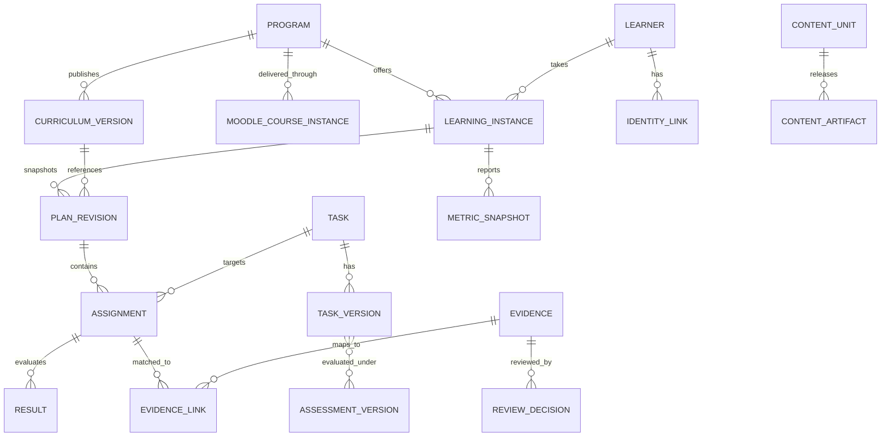

# 03 — Contracts, entities, endpoints, canonical normalization

## Entity relationships (logical)

Canonical IDs should be opaque internal UUID/ULID with stable externally visible slugs. Never use only email, display name or raw task title as key. Composite external ID is (`source_instance`, `object_type`, `external_id`).

## Key entities and required fields

| Entity | Core fields | Uniqueness / integrity |
|---|---|---|
| Program | `id, slug, name, model_policy, status` | slug unique per institution |
| SourceConnection | `id, type, base_uri, secret_ref, status, scopes` | secrets never in API output |
| ExternalObject | `source_id, type, external_id, source_updated_at, raw_ref, hash` | unique triple |
| Learner | `id, display_name, state` | separate access-controlled PII |
| IdentityLink | `learner_id, source_id, external_user_id, state, provenance` | manual resolution for conflicts |
| LearningInstance | `id, program_id, learner_id, started_at, state, locked_curriculum_id, active_plan_revision` | support repeat enrollment with sequence |
| Task | `id, slug, title, skill_tags` | slug stable |
| TaskVersion | `id, task_id, version, content_ref, assessment_ref` | published immutable |
| CurriculumVersion | `id, program_id, release, manifest_sha, released_at` | immutable + unique release |
| PlanRevision | `id, learning_instance_id, revision, curriculum_version_id, effective_at, approved_by` | immutable; one active pointer |
| Assignment | `id, plan_revision_id, task_id, required, weight, due_at, source_reason` | one task can have multiple attempts/evidence |
| Evidence | `id, source_ref, type, happened_at, payload_hash, raw_ref` | idempotency by origin |
| EvidenceLink | `evidence_id, assignment_id, state, matched_by, rule_version` | M:N; audit changes |
| Result | `assignment_id, status, score, max_score, assessment_version_id, decided_at` | normalized view from evidence and policies |
| ReviewCase | `id, reason, candidates, priority, state, source_revision` | optimistic concurrency |
| ReviewDecision | `review_case_id, action, actor, timestamp, evidence_refs, supersedes` | append-only |
| MetricSnapshot | `learning_instance_id, plan_revision, metric_version, as_of, calculated_at, values, quality` | versioned history |

## Source mapping examples

| External object | Canonical relation | Caveat |
|---|---|---|
| Moodle `cmid` / quiz instance | Activity/TaskVersion and assessment mapping | module IDs change on cloning |
| Moodle grade item + grade | Result evidence | not necessarily full attempt history |
| Moodle assignment URL submission | Evidence referencing GitLab MR | URL may be malformed or multiple |
| GitLab `project_id` + MR `iid` | Evidence; one-to-many links | merge alone is not completion |
| GitLab `head_sha`, diff version | Evidence revision | re-review on meaningful content change |
| Sheets tab/range/row | Proposed plan assignment | missing row not necessarily deleted |
| Custom interactive event | Attempt or result evidence | validate authenticated launch/session |

## API surface (illustrative, not yet implementation)

| Method | Path | Purpose | Safety |
|---|---|---|---|
| GET | `/api/v1/programs` | List program configuration and health | RBAC |
| POST | `/api/v1/programs/{id}/sources:discover` | Trigger source inventory | staff-only, read-only adapters |
| GET | `/api/v1/programs/{id}/catalog` | Tasks/activities/unmapped records | source provenance |
| GET | `/api/v1/learners/{id}/instances` | Learning attempts | scope authorization |
| GET | `/api/v1/learning-instances/{id}/plan` | Current/historical applicable obligations | revision/as_of |
| GET | `/api/v1/analytics/students` | Student metrics and data-health | filter by program/group/version |
| GET | `/api/v1/analytics/groups` | Group aggregate metrics | distinct per-group denominators |
| GET | `/api/v1/evidence/{id}` | Raw reference + linked canonical decision | redact secrets/PII |
| GET | `/api/v1/review-cases` | Pending manual matching | priority/filter |
| POST | `/api/v1/review-cases/{id}:decide` | Confirm/reject/defer links | revision precondition, audit |
| GET | `/api/v1/curricula/{id}/versions` | Published versions | immutable release |
| POST | `/api/v1/learning-instances/{id}/migrations:preview` | Simulate new plan and transfers | no write |
| POST | `/api/v1/learning-instances/{id}/migrations:apply` | Apply approved migration | approval/idempotency/expected revision |
| POST | `/internal/content/resolve` | Versioned artifact for authenticated Moodle user | server-to-server verified context |
| GET | `/api/v1/sync-runs` | Health and errors | admin |

### Content resolver request/response

Moodle plugin obtains `moodle_user_id`, course/activity from authenticated server context, then server-to-server resolves the locked learning instance. It should **not** trust client-supplied `email`, `user_id`, `version`, or bare URL parameters. Return exact immutable artifact hash and signed launch context. Version resolution is fast, synchronous and independent from analytics daily jobs. Cache only already-verified locks. On failure for a new user, fail closed; never route existing v1 student to v5 `latest`.

### Learning start behavior

Suggested `first_meaningful_action` configurable per program. An explicit `Start course` button gives the clearest event; else first plugin assessment attempt/Quiz attempt. For historical enrollments, imported start date/lock may be uncertain; flag `start_source=estimated` and require approval when migration sensitive.

### Plan update rules

A sheet import yields `plan_change_proposal`, not immediate student plan mutation. Publish a revision only via configured staff approval. Changes to existing students require a migration or plan-change policy, retaining old snapshots. A student may remain on curriculum v1 even as default release v5 changes.

### Result statuses

`NOT_ASSIGNED`, `NOT_STARTED`, `IN_PROGRESS`, `SUBMITTED`, `UNDER_REVIEW`, `CHANGES_REQUESTED`, `ACCEPTED`, `FAILED`, `EXEMPT`, `UNKNOWN`; downstream metrics must define which count as completed/grade eligible. Avoid overloading `merged` or `approved` with `ACCEPTED` unless a course-specific policy explicitly maps it.

### Migration status and result transfer

Migration decision statuses: `CARRY_OVER`, `REASSESS`, `SUPPLEMENT`, `NEW_REQUIRED`, `RETIRED`, `MANUAL_REVIEW`. Only approved mappings carry credit; no equivalence by name similarity. Show old/new progress as separate metrics with plan versions; preserve original grade/evidence and don't fabricate native Moodle attempts.

### Audit / event transport

Use an outbox pattern for grade-sensitive/migration events if integration writes ever become necessary. Include `event_id`, `event_type`, `schema_version`, `occurred_at`, `recorded_at`, `actor/source`, `subject_id`, `idempotency_key`, `raw_ref`, `correlation_id`. Replay events without duplicating accepted results. On partial failures persist unresolved sync and retry without destroying last valid state.

### Source-to-result trace

`MetricSnapshot → Result → Assignment → PlanRevision → CurriculumVersion` and `Result → EvidenceLink → Evidence → ExternalObject + RawSnapshot`; include human review decision if applicable.

